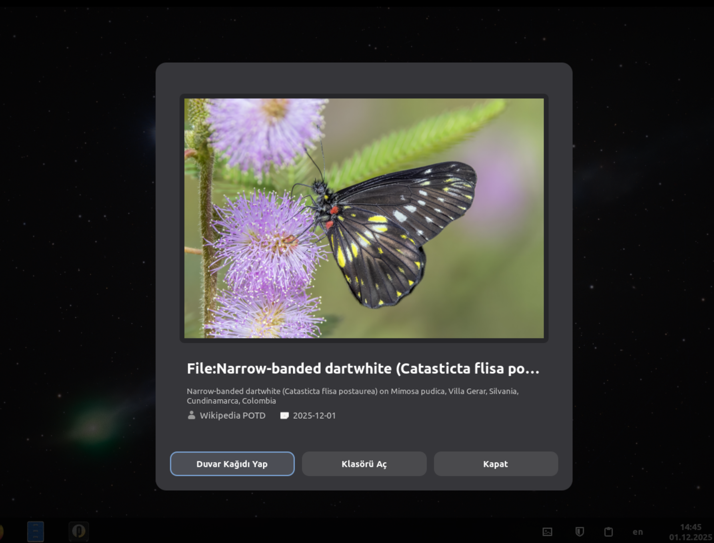
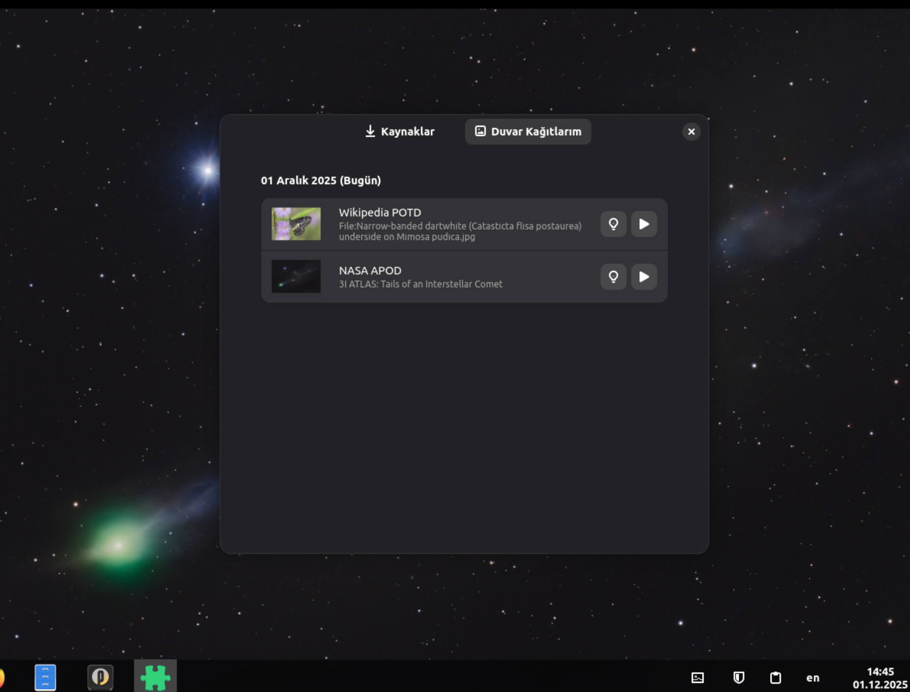

# Pardus Daily Wallpaper Extension

A GNOME Shell extension that automatically downloads and shuffles wallpapers from various sources like NASA APOD, Wikipedia POTD, and more.

<p align="center">
  
</p>
<p align="center">
  
</p>

## Features

- **Automatic Downloads**: Fetches daily wallpapers from configured sources.
- **Variety**: Supports multiple sources with different API structures.
- **Metadata**: Saves title, description, and copyright info for each wallpaper.
- **Configurable**: Users can select which sources to use.

## Installation

### Install from Source (Meson)

To build and install the extension system-wide (or to your local prefix):

```bash
meson setup build
ninja -C build
sudo ninja -C build install
```

### Manual Installation

1. Download the extension.
2. Copy the `pardus-daily-wallpaper@pardus.org.tr` folder to `~/.local/share/gnome-shell/extensions/`.
3. Compile the schemas:
   ```bash
   glib-compile-schemas ~/.local/share/gnome-shell/extensions/pardus-daily-wallpaper@pardus.org.tr/schemas/
   ```
4. Restart GNOME Shell (Log out and back in, or press `Alt+F2`, type `r`, and hit Enter on X11).
5. Enable the extension using **Extensions** or **Extension Manager**.

## Debian Packaging

This project includes the necessary `debian/` directory to build a Debian package (`.deb`).

To build the package:

1. Ensure you have the build dependencies installed:
   ```bash
   sudo apt install debhelper meson git
   ```

2. Run the package build command from the project root:
   ```bash
   dpkg-buildpackage -us -uc
   ```

3. The resulting `.deb` file will be generated in the parent directory. You can install it using:
   ```bash
   sudo dpkg -i ../gnome-shell-extension-pardus-daily-wallpaper_*.deb
   ```

## Contributing New Wallpaper Sources

You can add new wallpaper sources by editing the `data/wallpaper_sources.json` file. This file defines how the extension interacts with different APIs.

### Source Configuration Structure

Each source is defined by a key (e.g., `"nasa"`) and a configuration object:

```json
"source_key": {
  "name": "Display Name",
  "description": "Description of the source",
  "enabled": true,
  "api_url": "https://api.example.com/daily?date={year}-{month}-{day}",
  "headers": {
    "User-Agent": "PardusDailyWallpaper/1.0"
  },
  "response_mapping": {
    "title_keys": ["title", "copyright_text"],
    "description_keys": ["explanation"],
    "image_url_keys": ["hdurl", "url"],
    "image_url_prefix": ""
  }
}
```

### How API Parsing Works

The extension parses APIs dynamically based on the configuration provided in `wallpaper_sources.json`. Here is the flow:

1.  **URL Construction**:
    The `api_url` can contain placeholders `{year}`, `{month:02d}`, and `{day:02d}` which are replaced with the current date.

2.  **Data Extraction (`response_mapping`)**:
    The extension fetches the JSON response from the API and maps fields using the keys defined in `response_mapping`.

    -   **`title_keys`**: A list of keys to check for the image title. The first found key is used.
    -   **`description_keys`**: A list of keys for the image description.
    -   **`image_url_keys`**: A list of keys to find the direct URL of the image.
    -   **`data_path`** (Optional): If the relevant data is nested inside a specific property (e.g., `{"data": { ... }}`), specify the path here (e.g., `"data"`).
    -   **`find_first_valid`** (Advanced): For APIs returning an array, this allows filtering to find the first item that matches specific criteria (e.g., skipping videos).

3.  **Nested Properties**:
    You can access nested properties in the JSON response using dot notation (e.g., `"image.source"`).

### Example: Adding a Simple JSON Source

If an API returns:
```json
{
  "copyright": "Photographer Name",
  "date": "2023-10-27",
  "title": "Beautiful Scenery",
  "url": "https://example.com/image.jpg"
}
```

Your configuration would look like:
```json
"mysource": {
  "name": "My Source",
  "api_url": "https://api.example.com/today",
  "response_mapping": {
    "title_keys": ["title"],
    "copyright_keys": ["copyright"],
    "image_url_keys": ["url"]
  }
}
```

## License

GPL-3.0-or-later
